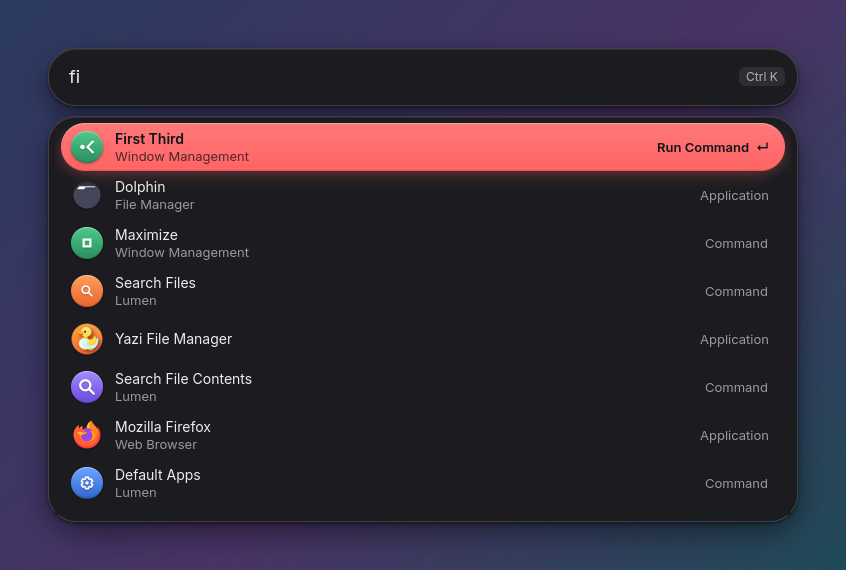
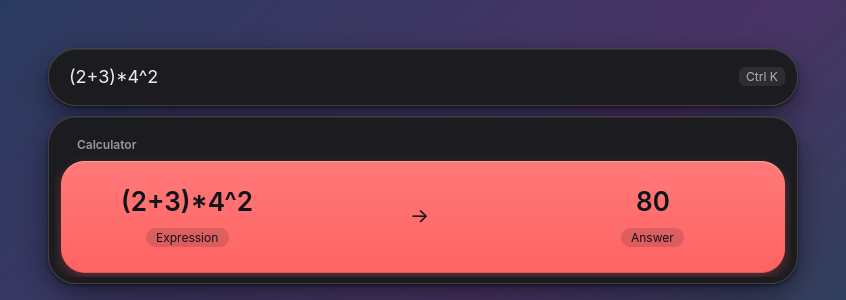
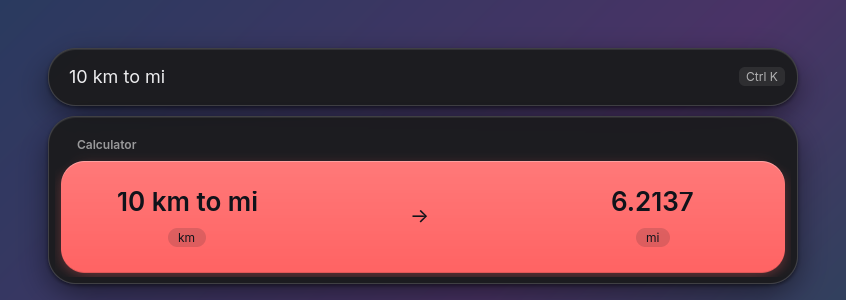
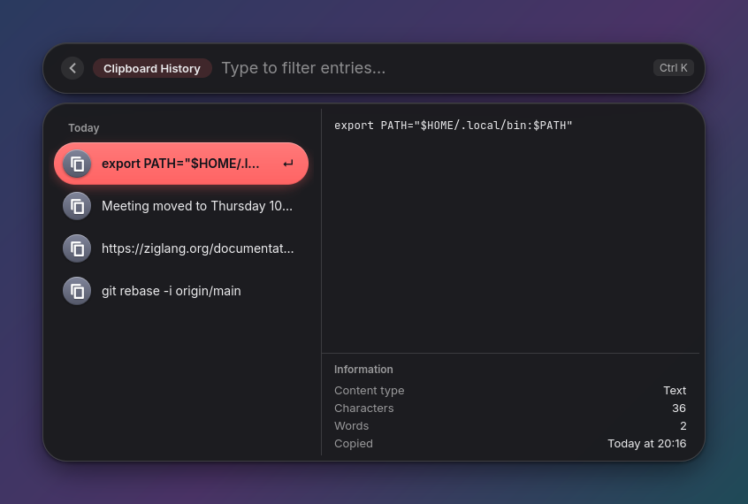
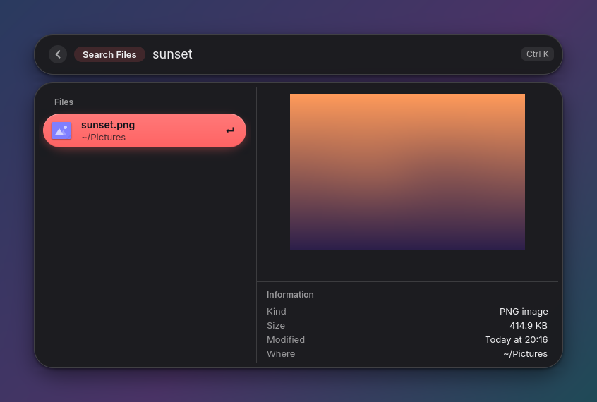
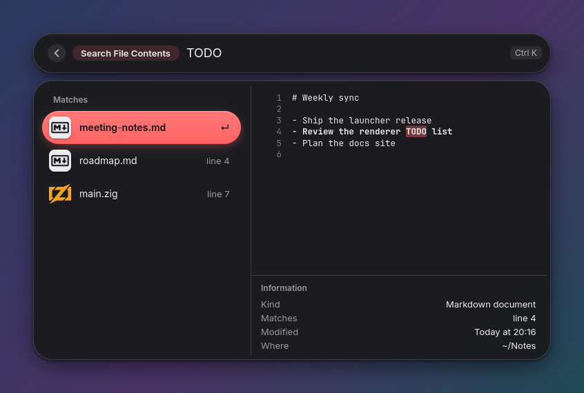
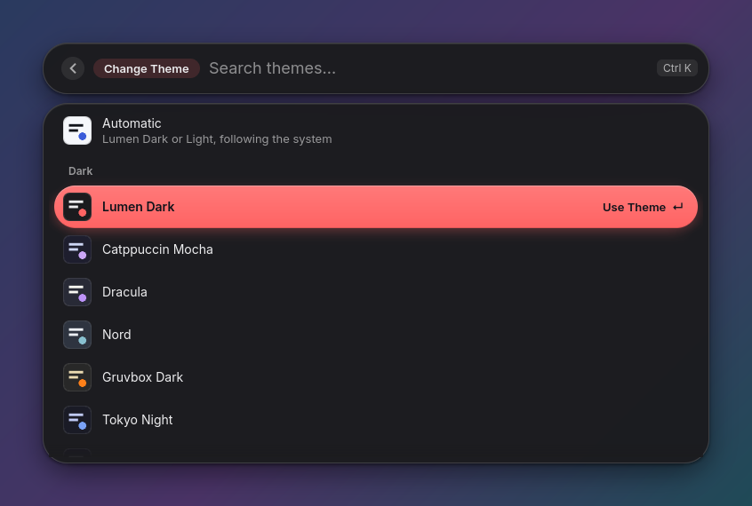
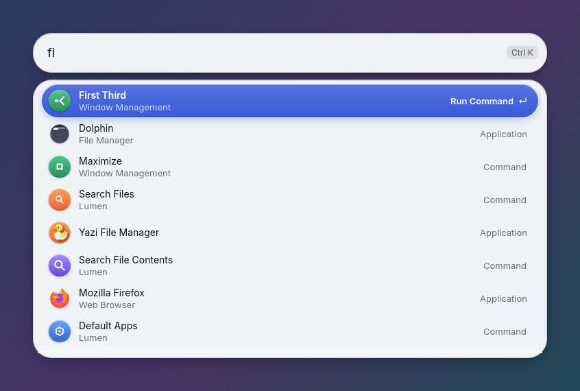
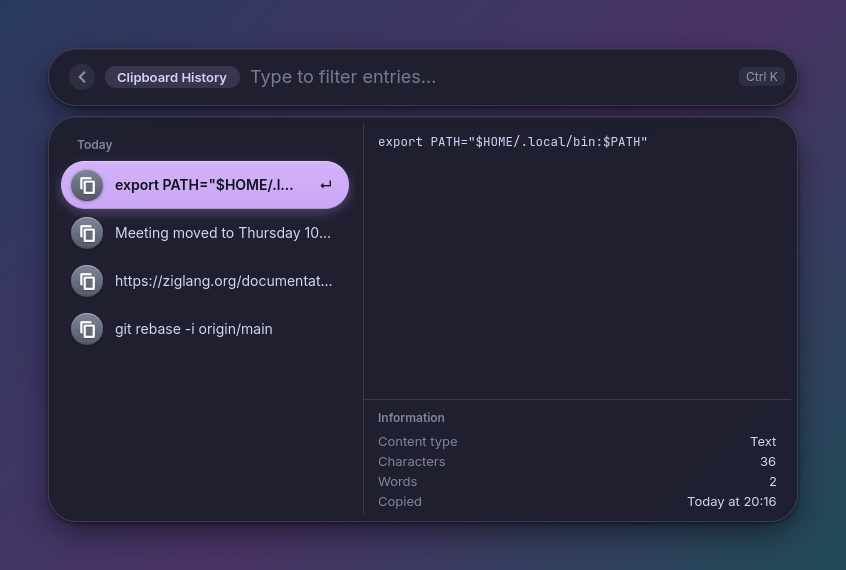

# Lumen

[](https://github.com/Osmait/lumen/actions/workflows/ci.yml)
[](LICENSE)

A fast, native launcher for Linux on Wayland, built for Hyprland. Apps,
calculator, clipboard history, file and file-content search, windows, window
management, system commands and your own scripts, behind one keystroke.

Written in Zig with GTK4 and gtk4-layer-shell. No Electron, no web view, no
network: it starts in about 100 ms, idles at 0 % CPU and keeps everything on
your machine.



## Features

| | |
|---|---|
| **Apps** | every installed app, fuzzy search that learns what you open most |
| **Calculator** | `2+3*4`, `(1+2)^3`, `sqrt(16)`, `5!`, `20% of 80`, `0xff`, and units: `10 km to mi`, `100 f in c`, `5 gb to mb` |
| **Clipboard history** | text you copy, with a preview; paste it straight into the app you came from |
| **Search files** | everything in your home folder, kept up to date as files change, with image and text previews |
| **Search file contents** | text inside code, notes, PDFs and Office documents; jump to the matching line in your editor |
| **Windows** | switch to or close any open window |
| **Window management** | halves, thirds, maximize, center, floating, fullscreen, move to the next display or workspace |
| **System** | lock, sleep, restart, shut down, log out, volume, microphone, media keys, dark mode, empty trash |
| **Extensions** | commands of your own in Lua, with lists, search and actions; themes, shortcuts and CSS of your own too |
| **Script commands** | your own scripts in `~/.config/lumen/scripts`, run from the launcher |
| **Themes** | 13 built in (Lumen, Catppuccin, Dracula, Nord, Gruvbox, Tokyo Night, Rosé Pine, One Dark, Solarized) plus Automatic, previewed live |
| **Default apps** | choose which app opens each kind of file, or a single file with Open With |

Search ignores case and accents everywhere: `accion` finds *acción*.

| | |
|---|---|
|  |  |
|  |  |
|  |  |
|  |  |

## Requirements

- Linux on Wayland. Lumen is built and tested on **Hyprland**. The launcher
  itself only needs a compositor with the layer-shell protocol (Sway, river,
  KDE...), but window search, window management and placing the window on the
  focused monitor talk to Hyprland; on other compositors they do nothing.
  Reports from other compositors are welcome.
- [Zig 0.17](https://ziglang.org/download/) to build.
- GTK 4, gtk4-layer-shell, SQLite and Lua 5.4.
- At run time, for the features that use them: `wl-clipboard` and `wtype`
  (clipboard, paste), `ripgrep` (file contents), `poppler` and `unzip` (PDF and
  Office documents), `wpctl` (volume), `playerctl` (media keys).

| Distribution | Packages |
|---|---|
| Arch | `sudo pacman -S gtk4 gtk4-layer-shell sqlite lua54 wl-clipboard wtype ripgrep poppler unzip wireplumber playerctl` |
| Fedora | `sudo dnf install gtk4-devel gtk4-layer-shell-devel sqlite-devel lua-devel wl-clipboard wtype ripgrep poppler-utils unzip wireplumber playerctl` |
| Debian / Ubuntu | `sudo apt install libgtk-4-dev libgtk4-layer-shell-dev libsqlite3-dev liblua5.4-dev wl-clipboard wtype ripgrep poppler-utils unzip wireplumber playerctl` |

Names can differ between releases; gtk4-layer-shell is packaged in recent
ones (for example Debian 13 and Ubuntu 24.04). Fedora names Lua 5.4 `lua` for
pkg-config: build there with `zig build -Dlua-pkg=lua ...`.

## Install

```sh
git clone https://github.com/Osmait/lumen.git
cd lumen
zig build -Doptimize=ReleaseSafe
install -Dm755 zig-out/bin/lumen ~/.local/bin/lumen
```

Make sure `~/.local/bin` is on your `PATH`.

## Set up

Lumen runs as a small daemon and shows its window when you call it. In
`~/.config/hypr/hyprland.conf`:

```ini
exec-once = lumen --daemon
bind = ALT, SPACE, exec, lumen

# Frosted glass behind the search bar and the results, not their shadows.
layerrule = blur true,match:namespace lumen
layerrule = ignore_alpha 0.45,match:namespace lumen
```

On another compositor, start `lumen --daemon` with your session and bind a
key to `lumen`.

The first start indexes your home folder in the background; file search
works right away and fills in within seconds.

## Usage

| Key | |
|---|---|
| `↑` `↓`, `Ctrl+N` `Ctrl+P` | move |
| `↵` | run the selected item (the row says what it does) |
| `Ctrl+↵` | the second action (open a new window, reveal a file...) |
| `Ctrl+K` | all actions for the selected item |
| `Ctrl+O` | open a file with another app |
| `Esc` | clear, go back, hide |
| `Backspace` on an empty search | go back |
| `Ctrl+X` | delete a clipboard entry |

Clicking outside the window closes it.

From the command line:

```
lumen                        show or hide the window (starts the daemon if needed)
lumen --view clipboard       open a view: root, clipboard, windows, files, contents,
                             settings, themes, default_apps
lumen --query "10 km to mi"  open with a search typed
lumen --show | --hide | --quit
lumen --stats                memory, index and latency numbers
lumen --command github.prs   open an extension's command
lumen --reload               load init.lua and the extensions again
```

So you can bind a key straight to clipboard history:

```ini
bind = ALT SHIFT, V, exec, lumen --view clipboard
```

### Pick from a list in your scripts

`lumen --dmenu` works like dmenu or `rofi -dmenu`: it shows the lines it
reads on stdin, prints the one you pick, and exits 0; Esc exits 1 with nothing
printed. Ctrl+Enter, or Enter when nothing matches, prints what you typed.

```sh
choice=$(printf 'Lock\nSuspend\nReboot\n' | lumen --dmenu --prompt Power) || exit
git branch --format='%(refname:short)' | lumen --dmenu --prompt Branch | xargs git switch
```

Lines show as they arrive, so a slow command does not hold the window up.
rofi's row options work too: `printf 'Firefox\0icon\x1ffirefox\n'` shows an
icon, and `meta` adds words to search by. It needs Lumen running (the daemon).

## Script commands

Any executable in `~/.config/lumen/scripts` with a header like this shows up
in the launcher:

```sh
#!/bin/bash
# @lumen.title Restart Waybar
# @lumen.mode silent
# @lumen.icon 🔄
# @lumen.packageName Desktop

pkill waybar; waybar &
```

`mode` is `silent` to just run it; any other mode (`compact`, `fullOutput`,
`inline`) shows the last lines of its output as a notification. Script commands written for other
launchers with `@raycast.*` keys work unchanged. See
[`examples/scripts`](examples/scripts).

## Extensions

For more than a script, write an extension in Lua: commands with a list to
search, rows with a detail pane, and actions for Enter, Ctrl+Enter and the
action panel. `~/.config/lumen/extensions/hello/init.lua`:

```lua
local lumen = require("lumen")

return lumen.extension {
  title = "Hello",
  commands = {
    {
      name = "shout",
      title = "Shout",
      search = function(query)
        local loud = query:upper() .. "!"
        return { { title = loud, actions = { lumen.action.paste(loud), lumen.action.copy(loud) } } }
      end,
    },
  },
}
```

`lumen.exec` runs programs and `lumen.json` reads their output, so the
command-line tools you already use can become commands. In
`~/.config/lumen/init.lua` you can add your own themes and keyboard shortcuts,
and `~/.config/lumen/style.css` can restyle anything.

Extensions can answer in the main search too (type "time tokyo" with the
world clock example), declare preferences, which show in Settings, and keep
data between runs with `lumen.storage`.

[EXTENSIONS.md](EXTENSIONS.md) is the full guide.
[`examples/`](examples) has a GitHub extension (your pull requests, issues
and repositories through `gh`), a process list, quick notes, a world clock,
a "New File" form, an emoji picker, a wallpaper browser, and a sample
`init.lua` and `style.css`.

## Configuration

Search for **Settings** in Lumen to change the theme, text size, opacity,
window position, width and height, how dense the rows are, what the main
search shows, clipboard history, your terminal and the editor used to open
search results at the matching line. **Change
Theme** previews every theme as you move through the list, and **Default
Apps** picks the app for each kind of file.

Everything is saved in `~/.config/lumen/settings.conf`, which you can also
edit by hand; Lumen picks up changes the next time its window opens. Some
things can only be set there, like an app for a single file extension:

```ini
theme = catppuccin-mocha
text_size = large
width = wide
density = compact
clipboard_keep = 500
terminal = kitty

[open-with]
pdf = org.gnome.Papers.desktop
.log = org.gnome.TextEditor.desktop
```

## Privacy

Lumen makes no network connections and sends nothing anywhere. What it keeps
stays on your disk, readable only by you:

| | |
|---|---|
| `~/.config/lumen/` | settings, `init.lua`, extensions and script commands |
| `~/.local/share/lumen/lumen.db` | clipboard history and how often you open things |
| `~/.cache/lumen/` | the file and content indexes, and text extracted from documents |

Extensions and script commands you add run as you and do what their code
does, network included; read them before installing them.

Copies made by password managers are not stored (they mark them as secret),
and clipboard history can be turned off in Settings. Deleting those folders
resets Lumen completely.

## Contributing

Bug reports, ideas and pull requests are welcome; see
[CONTRIBUTING.md](CONTRIBUTING.md). How Lumen works inside, and what was
measured to make it fast, is in [ARCHITECTURE.md](ARCHITECTURE.md).

## License

MIT, see [LICENSE](LICENSE). The language logos in `src/ui/icons/devicon/`
come from [Devicon](https://devicon.dev) (MIT, see the license there).
