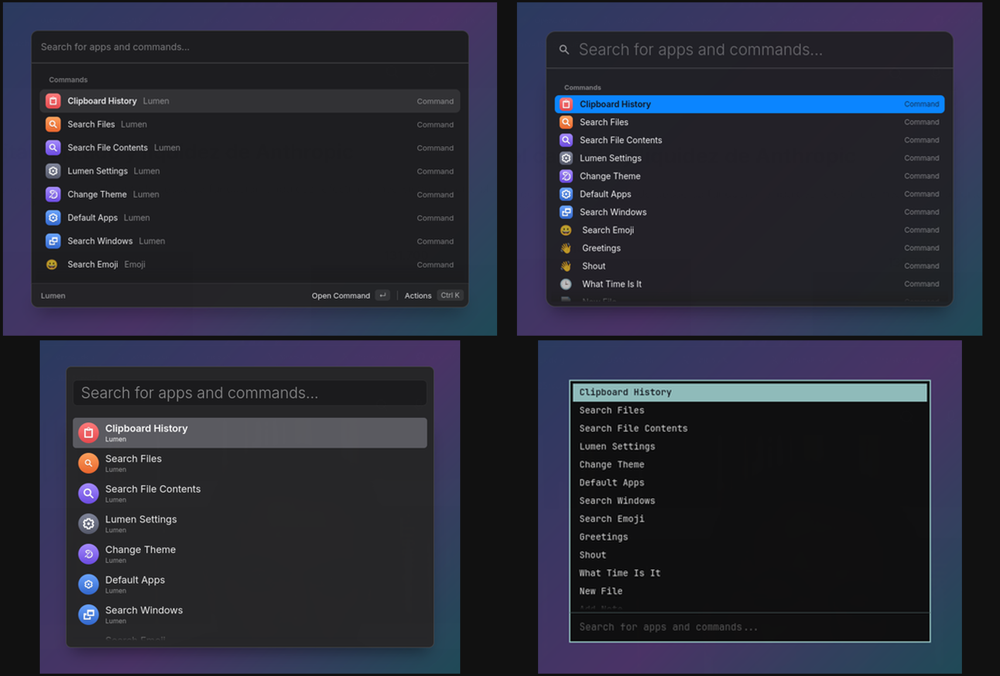
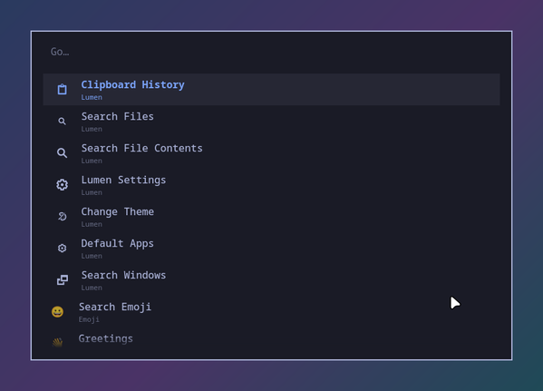

# Styles

Four complete looks for Lumen, each an `init.lua` (the window's structure
with `lumen.layout`, a theme, a few settings) and a `style.css` (the finer
details).



| | |
|---|---|
| [`raycast`](raycast) | One panel, a footer that says what Enter does, subtitles beside titles, a grey selection. |
| [`spotlight`](spotlight) | A large search field with a magnifier, compact rows with titles only, macOS blue. |
| [`alfred`](alfred) | A framed search field inside the panel, tall rows with large icons. |
| [`minimal`](minimal) | rofi-like: text only, monospace, square, the search field at the bottom. |
| [`omarchy`](omarchy) | Omarchy's menu: a square card with a 2px border, monospace, "Go…", the screen dimmed behind. All 23 Omarchy palettes, and on Omarchy it follows the theme you pick there. |



On Omarchy, make Lumen switch with the system theme at once: install the
hook that comes with the style,

```sh
install -Dm755 examples/styles/omarchy/theme-set-hook ~/.config/omarchy/hooks/theme-set.d/lumen
```

(without it, Lumen picks the new theme up the next time its window opens).

To use one:

```sh
cp examples/styles/raycast/init.lua ~/.config/lumen/init.lua
cp examples/styles/raycast/style.css ~/.config/lumen/style.css
lumen --reload
```

If you already have an `init.lua`, paste the style's `lumen.theme`,
`lumen.set` and `lumen.layout` calls into it instead. Every option is in
[EXTENSIONS.md](../../EXTENSIONS.md#layout).

They imitate the look, not the trade marks: no logos, and no fonts shipped.
The Raycast, Spotlight and Alfred styles use Apple's SF Pro when it is
installed on your system and Inter otherwise. Any font can be used the same
way, in style.css:

```css
.shell, .actions { font-family: "Your Font", "Inter", sans-serif; }
```
